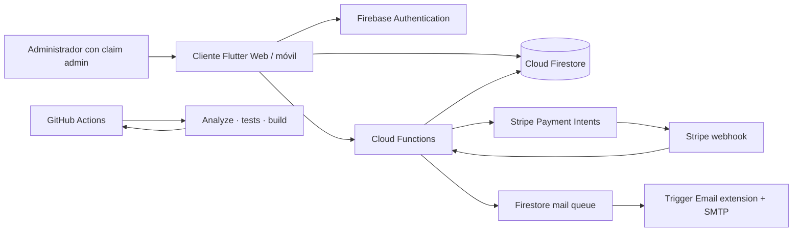

# Arquitectura

## Responsabilidades

- **Flutter** ofrece catálogo, búsqueda, filtros, opciones de producto, carrito local, direcciones guardadas, cupones, checkout y seguimiento de pedidos.
- **Authentication** identifica clientes. El claim personalizado `admin` habilita las pantallas administrativas.
- **Firestore** almacena catálogo, opciones, inventario, cupones, direcciones y pedidos. Las reglas limitan cada escritura al actor correspondiente.
- **Cloud Functions** recalcula precios, verifica opciones y stock, reserva unidades y usos de cupones, crea pagos y finaliza pedidos de forma idempotente.
- **Stripe** recibe el pago. El Payment Sheet confirma desde el cliente; el webhook de Stripe puede finalizar el pedido incluso si el cliente pierde conexión.
- **Correo** se encola solo después de confirmar el pago. La extensión oficial `firestore-send-email` entrega el correo usando un proveedor SMTP configurado.

## Variantes e inventario

Las opciones (por ejemplo, talla y color) se guardan en el documento del producto. En este demo comparten las existencias totales del producto; para inventario por combinación, modela cada variante como un documento de inventario independiente antes de venderlo.

## Promociones

Los códigos viven en `coupons/{CODIGO}`. El servidor valida vigencia, mínimo, porcentaje o monto fijo, y limita usos mediante reservas transaccionales. El cliente solo presenta una estimación; el monto cobrado se calcula otra vez en el servidor.

## Estados de pedido

`paid → processing → shipped → delivered`. Solo una Cloud Function con claim administrativo puede avanzar un pedido, y cada transición se valida contra el estado actual.

## Publicación

Firebase Hosting sirve `build/web`. El workflow de GitHub Actions analiza Dart, ejecuta pruebas, compila web y revisa la sintaxis de Functions. Ningún secreto de Firebase o Stripe se guarda en el repositorio.
